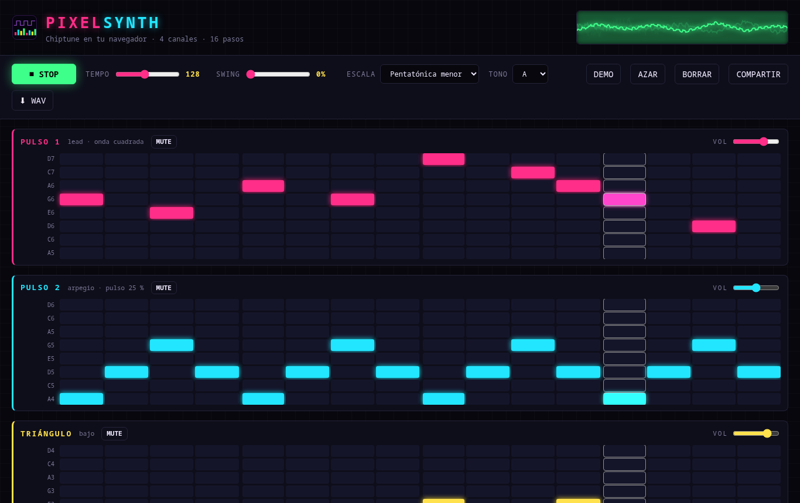

<div align="center">



### Chiptune de 4 canales en tu navegador. Sin instalar nada.

<a href="https://neckhurtttt.github.io/PixelSynth/"></a>




</div>

## 🎛️ Qué hace

Un secuenciador de 16 pasos con **cuatro canales**, como las consolas de 8 bits:

| Canal | Sonido | Para qué |
|---|---|---|
| **PULSO 1** | onda cuadrada con vibrato | melodía |
| **PULSO 2** | pulso al 25 % (serie de Fourier) | arpegios |
| **TRIÁNGULO** | onda triangular | bajo |
| **RUIDO** | registro de desplazamiento (LFSR) de 15 bits | bombo, caja y hats |

- Clic o **arrastrar** para pintar notas; las notas siempre caen en la **escala** elegida (pentatónicas, menor, dórica, frigia…) y en el **tono** que quieras.
- **Tempo** y **swing**, mute y volumen por canal, **osciloscopio** en vivo.
- **DEMO** y **AZAR** para empezar rápido.
- **COMPARTIR**: toda la canción se guarda en la URL.
- **⬇ WAV**: renderiza 4 vueltas con `OfflineAudioContext` y las baja como `.wav`.
- Teclas `A S D F G H J K` para tocar en vivo y `Espacio` para play/stop.

## ⚙️ Cómo funciona

El programador de notas mira 120 ms hacia adelante y agenda cada nota en el reloj de audio (`AudioContext.currentTime`), así el ritmo no depende de `setTimeout`. El ruido sale de un LFSR como el de las consolas viejas, y el pulso del 25 % se arma con 64 armónicos en un `PeriodicWave`.

## ▶️ Usarlo

```sh
python3 -m http.server 8000   # y abre http://127.0.0.1:8000
```

<div align="center"><sub>PIXELSYNTH · hecho por <a href="https://github.com/NeckHurtttt">NeckHurtttt</a></sub></div>
